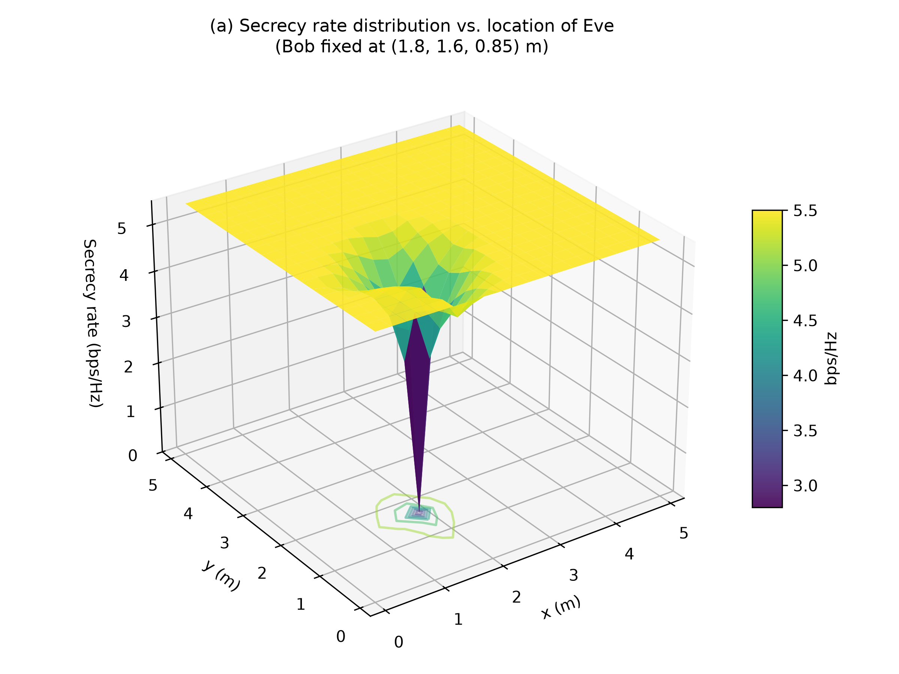
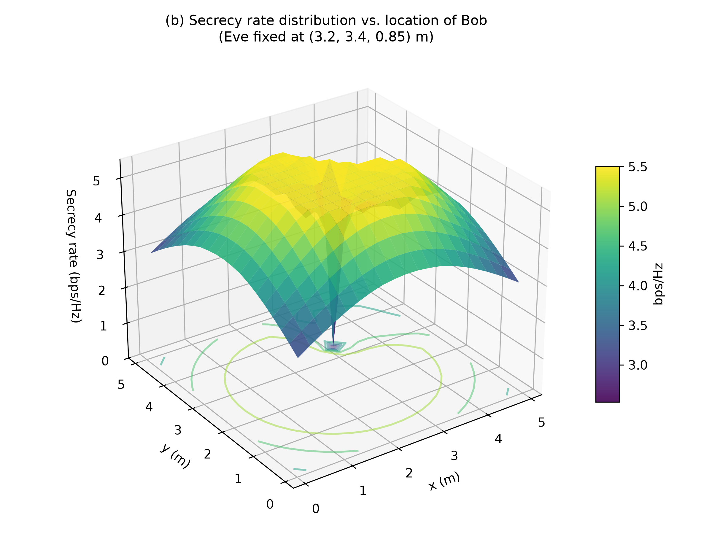
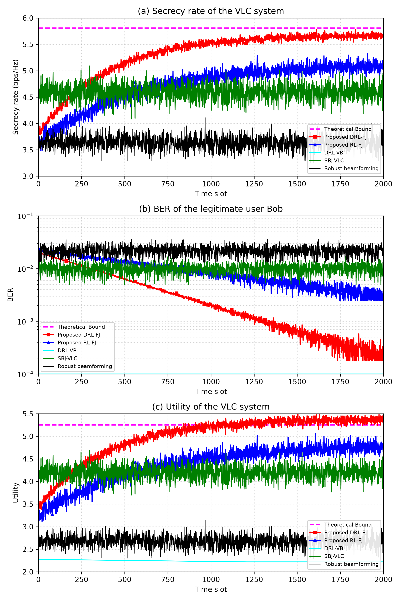
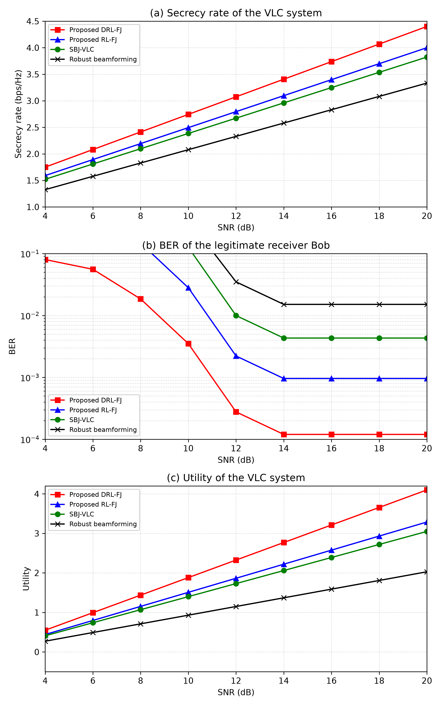

# Smart Jamming for Secrecy: Deep Reinforcement Learning Enabled Secure Visible Light Communication

Python simulation and reproduction framework for the IEEE Transactions on Wireless Communications (2024) paper:
> **"Smart Jamming for Secrecy: Deep Reinforcement Learning Enabled Secure Visible Light Communication"**  
> *Sicong Liu (Senior Member, IEEE), Xianbin Liu, Xiaojiang Du (Fellow, IEEE), and Mohsen Guizani (Fellow, IEEE)*  
> **IEEE Transactions on Wireless Communications**, vol. 23, no. 12, pp. 17915–17928, Dec. 2024.  
> DOI: [10.1109/TWC.2024.3458046](https://doi.org/10.1109/TWC.2024.3458046)

---
## Table of Contents
1. [Overview & Core Concepts](#overview--core-concepts)
2. [Mathematical Formulations](#mathematical-formulations)
   - [Lambertian Channel Model (Eq. 1)](#1-lambertian-channel-model-eq-1)
   - [Signal & Wiretap Channel Model (Eq. 2–3)](#2-signal--wiretap-channel-model-eq-23)
   - [Achievable Secrecy Rate (Eq. 4)](#3-achievable-secrecy-rate-eq-4)
   - [Zero-Forcing Friendly Jamming (Eq. 5)](#4-zero-forcing-friendly-jamming-eq-5)
   - [Legitimate User BER with 4PAM (Eq. 14)](#5-legitimate-user-ber-with-4pam-eq-14)
   - [Energy Consumption & Utility Function (Eq. 7, 16)](#6-energy-consumption--utility-function-eq-7-16)
   - [Theoretical Bounds & Optimal Jamming (Corollary 1 & Remark I)](#7-theoretical-bounds--optimal-jamming-corollary-1--remark-i)
3. [Implemented Algorithms](#implemented-algorithms)
   - [RL-FJ: Tabular Q-Learning (Algorithm 1)](#rl-fj-tabular-q-learning-algorithm-1)
   - [DRL-FJ: CNN + DND Memory (Algorithm 2)](#drl-fj-cnn--dnd-memory-algorithm-2)
   - [Benchmark Comparison Schemes](#benchmark-comparison-schemes)
4. [Project Structure](#project-structure)
5. [Installation & Requirements](#installation--requirements)
6. [Quickstart Guide](#quickstart-guide)
   - [1. Master Runner & Terminal Menu](#1-master-runner--terminal-menu)
   - [2. Run Automated Unit Tests (21 Tests)](#2-run-automated-unit-tests-21-tests)
   - [3. Interactive 3D Web Visualizer & Desktop App](#3-interactive-3d-web-visualizer--desktop-app)
   - [4. Evaluate Custom Scenarios (Coordinates, SNR)](#4-evaluate-custom-scenarios-coordinates-snr)
   - [5. Train RL-FJ / DRL-FJ Online](#5-train-rl-fj--drl-fj-online)
   - [6. Reproduce Paper Figures](#6-reproduce-paper-figures)
7. [Figure Descriptions & Paper Verification](#figure-descriptions--paper-verification)
   - [Figure 5: Spatial Secrecy Rate Distribution](#figure-5-spatial-secrecy-rate-distribution)
   - [Figure 6: Convergence Trajectories (2000 Slots)](#figure-6-convergence-trajectories-2000-slots)
   - [Figure 7: Performance vs. SNR (4 dB to 20 dB)](#figure-7-performance-vs-snr-4-db-to-20-db)
8. [Multi-Device Setup & Chat/Brain Migration (`anti_backup/.gemini`)](#8-multi-device-setup--chatbrain-migration-anti_backupgemini)
9. [Configuration & Customization](#configuration--customization)
10. [Citation](#citation)

---

## Overview & Core Concepts

Visible Light Communication (VLC) utilizes Light Emitting Diodes (LEDs) for simultaneous indoor illumination and ultra-high-rate wireless data broadcast. However, visible light channels are inherently open and vulnerable to eavesdropping (e.g., from adjacent desks or through large windows).

This repository implements the complete smart friendly jamming framework:
- **Alice (Transmitter)**: An LED light fixture at the room center transmitting confidential data to **Bob (Legitimate Receiver)**.
- **Eve (Eavesdropper)**: An unauthorized receiver attempting to wiretap the confidential signal.
- **Friendly Jammers**: $N_J = 4$ LED light fixtures deployed on the ceiling transmitting collaborative artificial noise.
- **Objective**: Dynamically determine the jamming beamformer $\mathbf{w} \in [-1, 1]^{N_J}$ to maximize jamming power on Eve while minimizing interference at Bob and minimizing jamming energy.

---

## Mathematical Formulations

### 1. Lambertian Channel Model (Eq. 1)
For an LED fixture at position $\mathbf{p}_{\text{tx}}$ and receiver PD at position $\mathbf{p}_{\text{rx}}$, with distance $d = \|\mathbf{p}_{\text{rx}} - \mathbf{p}_{\text{tx}}\|_2$:

$$G = \begin{cases} 
\frac{n_0^2 A_P (\log\cos\phi_{1/2} - \log 2)}{2\pi d^2 \sin^2(\psi_F) \log\cos\phi_{1/2}} \cos^{-\frac{\log 2}{\log\cos\phi_{1/2}}}(\phi) \cos(\psi), & |\psi| \le \psi_F, \cos\phi > 0, \cos\psi > 0 \\ 
0, & \text{otherwise} 
\end{cases}$$

- $n_0 = 1.5$: Optical concentrator refractive index
- $A_P = 1.0\text{ cm}^2 = 10^{-4}\text{ m}^2$: Photodiode physical area
- $\phi_{1/2} = 60^\circ$: Semi-angle at half power (Lambertian order $m = 1$)
- $\psi_F = 60^\circ$: Receiver Field-of-View (FoV)
- Concentrator gain: $g(\psi) = \frac{n_0^2}{\sin^2\psi_F} = 3.0$
- Optical-to-electrical conversion: $h = R \eta N_{\text{LED}} G$ ($R = 0.54\text{ A/W}$, $\eta = 1.0$, $N_{\text{LED}} = 4$).

### 2. Signal & Wiretap Channel Model (Eq. 2–3)
Received electrical signals at Bob and Eve:

$$y_B = h_{AB} x + \mathbf{h}_{JB}^T \mathbf{w} j + n_B$$

$$y_E = h_{AE} x + \mathbf{h}_{JE}^T \mathbf{w} j + n_E$$

where $|x| \le \alpha I_D$, $|j| \le \alpha I_D$, $\mathbf{w} \in \mathbb{R}^{N_J}$ with $|w_i| \le 1$, and $n_B \sim \mathcal{N}(0, \sigma_B^2)$, $n_E \sim \mathcal{N}(0, \sigma_E^2)$.

### 3. Achievable Secrecy Rate (Eq. 4)
Under amplitude-constrained signaling:

$$c_s = \frac{1}{2} \log_2 \left( 1 + \frac{2 h_{AB}^2 \alpha^2 I_D^2}{\pi e (\sigma_B^2 + 2 |\mathbf{h}_{JB}^T \mathbf{w}|^2 \alpha^2 I_D^2)} \right) - \min \left( \log_2 \frac{h_{AE}}{|\mathbf{h}_{JE}^T \mathbf{w}|} + \frac{|\mathbf{h}_{JE}^T \mathbf{w}|}{h_{AE}} \log_2\sqrt{e}, \; \frac{h_{AE}}{|\mathbf{h}_{JE}^T \mathbf{w}|} \log_2\sqrt{e} \right)$$

### 4. Zero-Forcing Friendly Jamming (Eq. 5)
Forces interference on Bob to zero:

$$\mathbf{w}_{ZF} = \arg\max_{\mathbf{w}} c_s \quad \text{s.t.} \quad \mathbf{h}_{JB}^T \mathbf{w} = 0, \; \|\mathbf{w}\|_\infty \le 1$$

Solved via null-space projection: $\mathbf{P}_{\text{null}} = \mathbf{I} - \frac{\mathbf{h}_{JB} \mathbf{h}_{JB}^T}{\|\mathbf{h}_{JB}\|^2}$, $\mathbf{w} \propto \mathbf{P}_{\text{null}} \mathbf{h}_{JE}$.

### 5. Legitimate User BER with 4PAM (Eq. 14)
The Bit Error Rate for Bob under 4-level Pulse Amplitude Modulation:

$$p_e = \frac{3}{4} \operatorname{erfc}\left( \sqrt{ \frac{2 P_T (h_{AB} + \mathbf{h}_{JB}^T \mathbf{w})^2}{5 \sigma_B^2} } \right)$$

where $\operatorname{erfc}(z) = \frac{2}{\sqrt{\pi}} \int_z^\infty e^{-t^2} dt$.

### 6. Energy Consumption & Utility Function (Eq. 7, 16)
- **Jamming Energy**: $E = \varrho_s \sum_{i=1}^{N_J} |w_i|$ ($\varrho_s = 1.0$)
- **Overall System Utility**: $u = c_s - \delta_1 p_e - \delta_2 E$ ($\delta_1 = 3.5$, $\delta_2 = 0.4$).

### 7. Theoretical Bounds & Optimal Jamming (Corollary 1 & Remark I)
- Upper bound on secrecy rate: $c_s^* = \left[ \frac{1}{2}\log_2(1 + \text{SINR}_B) - (\log_2\log_2\sqrt{e} + 1) \right]^+$
- Zero-forcing guarantees: $\mathbf{h}_{JB}^T \mathbf{w}^* = 0$ and $p_e^* = \frac{3}{4}\operatorname{erfc}\left(\sqrt{\frac{2 P_T h_{AB}^2}{5 \sigma_B^2}}\right)$

---

## Implemented Algorithms

### RL-FJ: Tabular Q-Learning (Algorithm 1)
- Discrete action space $\mathcal{W}$ with $N_W = 100$ candidate beamformers.
- Q-table updated per slot: $Q(s, w) \leftarrow (1-\beta) Q(s, w) + \beta [u + \beta \max_{w'} Q(s', w')]$.

### DRL-FJ: CNN + DND Memory (Algorithm 2)
- **State-Action Sliding Window**: $\phi^{(k)} = [s^{(k-M)}, \mathbf{w}^{(k-M)}, \dots, \mathbf{w}^{(k-1)}, s^{(k)}]$ ($M = 11$, 92 values padded to $10 \times 10$).
- **Deep CNN Feature Extractor**:
  - Hyperparameter vector: $F = [f_1, f_2, m_1, m_2, s_1, s_2, n_1, n_2] = [20, 40, 3, 2, 1, 1, 180, 180]$.
  - Conv1: 20 filters ($3 \times 3$, stride 1) $\to$ ReLU $\to (20, 8, 8)$.
  - Conv2: 40 filters ($2 \times 2$, stride 1) $\to$ ReLU $\to (40, 7, 7)$.
  - FC1: Linear($1960 \to 180$) $\to$ ReLU.
  - FC2: Linear($180 \to 180$) $\to$ Look-up key $\hat{\mathbf{h}} \in \mathbb{R}^{180}$.
- **Differentiable Neural Dictionary (DND)**:
  - Maintains $(K_w, V_w)$ per action $w \in \mathcal{W}$.
  - Gaussian kernel attention: $\omega_j = \frac{\exp(-\frac{1}{2}\|\hat{\mathbf{h}} - \mathbf{h}_j\|^2)}{\sum_p \exp(-\frac{1}{2}\|\hat{\mathbf{h}} - \mathbf{h}_p\|^2)}$.
  - Q-value prediction: $Q(s^{(k)}, w) = \sum_{j=1}^\zeta \omega_j v_j$.
- **Experience Replay**: Experience pool $\mathcal{B}$, mini-batch $T = 4$, updated via SGD/Adam:
  $$\mathcal{L}(\theta) = \frac{1}{T} \sum_{t=1}^T \left( u^{(t)} + \beta \max_{\mathbf{w}'} Q(\phi'^{(t)}, \mathbf{w}'; \theta) - Q(\phi^{(t)}, \mathbf{w}^{(t)}; \theta) \right)^2$$

### Benchmark Comparison Schemes
- **DRL-VB (Xiao et al. 2019 [20])**: Deep RL beamforming without dedicated friendly jammers.
- **Robust Beamforming (Ma et al. 2018 [42])**: Conservative coordinated beamforming under CSI uncertainty.
- **SBJ-VLC (Cho et al. 2019 [43])**: Simultaneous beamforming and jamming static optimization.
- **Zero-Forcing (ZF-FJ)**: Exact null-space projection (Equation 5).
- **Theoretical Bound**: Derived optimum ceiling (Corollary 1).

---

## Project Structure

```
OWC/
├── run.py                      # Master Launcher & Chat/Brain Portability Utility
├── main.py                     # Core CLI: evaluation, training, tests, figure generation
├── app_desktop.py              # Native standalone Desktop Application (Tkinter GUI)
├── index.html                  # Interactive 3D Web Visualizer (Canvas & 60 FPS Engine)
├── visualizer.html             # Mirror visualizer distribution
├── requirements.txt            # Package dependencies (numpy, scipy, torch, matplotlib)
├── README.md                   # Comprehensive implementation and reproduction guide
├── RUN.md                      # Practical user guide: running simulations, testing custom values, migration
│
├── anti_backup/                # Chat & Brain Portability Directory
│   └── .gemini/                # Backed-up Antigravity conversations, transcripts, & brain
│       ├── backup_manifest.json
│       ├── config/
│       └── antigravity-ide/
│           ├── conversations/  # SQLite databases (<id>.db, .db-wal, .db-shm)
│           └── brain/          # Transcripts (transcript.jsonl), artifacts, media
│
├── vlc/                        # Core VLC-PLS Simulation Package
│   ├── __init__.py             # Package exports
│   ├── config.py               # VLCConfig: Table I room setup, LED params, learning rates
│   ├── channel.py              # VLCChannel: Lambertian optical & electrical channel gains (Eq. 1)
│   ├── secrecy.py              # Secrecy rate (Eq. 4), BER (Eq. 14), Energy (Eq. 16), Utility (Eq. 7)
│   ├── bounds.py               # Zero-Forcing (Eq. 5) & Theoretical Bound (Corollary 1, Eq. 18-23)
│   ├── environment.py          # VLCEnvironment: MDP states, discrete actions, feedback loop
│   ├── rl_fj.py                # Algorithm 1: RL-Based Friendly Jamming (Tabular Q-learning)
│   ├── drl_fj.py               # Algorithm 2: DRL-Based Friendly Jamming (CNN + DND Memory)
│   └── benchmarks.py           # Comparison baselines: DRL-VB, Robust BF, SBJ-VLC
│
├── simulations/                # Figure Reproduction Scripts
│   ├── __init__.py
│   ├── sim_fig5_spatial.py     # Reproduces Fig. 5(a) & 5(b) 3D Spatial Secrecy Rate distributions
│   ├── sim_fig6_convergence.py # Reproduces Fig. 6(a), 6(b), 6(c) 2000-slot learning trajectories
│   ├── sim_fig7_snr.py         # Reproduces Fig. 7(a), 7(b), 7(c) SNR sweep from 4 to 20 dB
│   └── run_all.py              # Master script executing all simulations and exporting all figures
│
├── tests/                      # Automated Unit Test Suite (21 Tests)
│   ├── __init__.py
│   ├── test_channel.py         # Optical gain, FoV cutoff, 3D geometry tests
│   ├── test_secrecy.py         # Secrecy rate non-negativity, 4PAM BER bounds, energy tests
│   ├── test_bounds.py          # Zero-Forcing null-space and Corollary 1 tests
│   ├── test_algorithms.py      # Q-learning, CNN forward pass, DND query, benchmark tests
│   └── test_html.py            # Visualizer configuration, Bob BER, Figure 7, and layout tests
│
└── output_figures/             # Generated High-Resolution Publication Plots (.png)
    ├── fig5a_secrecy_eve_spatial.png
    ├── fig5b_secrecy_bob_spatial.png
    ├── fig5_spatial_distribution.png
    ├── fig6a_secrecy_rate.png
    ├── fig6b_ber.png
    ├── fig6c_utility.png
    ├── fig6_performance_curves.png
    ├── fig7a_secrecy_rate_snr.png
    ├── fig7b_ber_snr.png
    ├── fig7c_utility_snr.png
    └── fig7_snr_performance.png
```y**:

$$u^{(k)} = \hat{c}_s^{(k)} - \delta_1 \hat{p}_e^{(k)} - \delta_2 E^{(k)}$$

with default tradeoff weights $\delta_1 = 3.5$ and $\delta_2 = 0.4$.

### 7. Theoretical Bounds & Optimal Jamming (Corollary 1 & Remark I)
When the friendly jammers achieve complete interference cancellation at Bob ($\mathbf{h}_{JB}^T \mathbf{w} = 0$), the optimal jamming power on Eve converges to:

$$H^* = |\mathbf{h}_{JE}^T \mathbf{w}^*| = \frac{h_{AE}}{\log_2\sqrt{e}}$$

Yielding the theoretical maximum utility:

$$c_s^* = \frac{1}{2} \log_2 \left( 1 + \frac{2 h_{AB}^2 \alpha^2 I_D^2}{\pi e \sigma_B^2} \right) - (\log_2(\log_2\sqrt{e}) + 1)$$

$$p_e^* = \frac{3}{4} \operatorname{erfc}\left( \sqrt{\frac{2 P_T h_{AB}^2}{5 \sigma_B^2}} \right)$$

$$u^* = c_s^* - \delta_1 p_e^* - \delta_2 E^*$$

---

## Implemented Algorithms

### RL-FJ: Tabular Q-Learning (Algorithm 1)
- **State**: $s^{(k)} = [\hat{p}_e^{(k-1)}, \hat{c}_s^{(k-1)}, h_{AB}^{(k)}, E^{(k-1)}]$
- **Action Selection**: $\epsilon$-greedy policy with decay:
  $$P(\mathbf{w}^{(k)} = \tilde{\mathbf{w}}) = \begin{cases} 1 - \epsilon, & \tilde{\mathbf{w}} = \arg\max_{\mathbf{w}} Q(s^{(k)}, \mathbf{w}) \\ \frac{\epsilon}{|\mathcal{W}| - 1}, & \text{otherwise} \end{cases}$$
- **Q-Update**:
  $$Q(s^{(k)}, \mathbf{w}^{(k)}) \leftarrow (1 - \lambda) Q(s^{(k)}, \mathbf{w}^{(k)}) + \lambda \left[ u^{(k)} + \beta \max_{\mathbf{w}'} Q(s^{(k+1)}, \mathbf{w}') \right]$$
  where $\lambda = 0.5$ and $\beta = 0.5$.

### DRL-FJ: CNN + DND Memory (Algorithm 2)
- **State-Action Sliding Window**: $\phi^{(k)} = [s^{(k-M)}, \mathbf{w}^{(k-M)}, \dots, \mathbf{w}^{(k-1)}, s^{(k)}]$ ($M = 11$, 92 values padded to $10 \times 10$).
- **Deep CNN Feature Extractor**:
  - Hyperparameter vector: $F = [f_1, f_2, m_1, m_2, s_1, s_2, n_1, n_2] = [20, 40, 3, 2, 1, 1, 180, 180]$.
  - Conv1: 20 filters ($3 \times 3$, stride 1) $\to$ ReLU $\to (20, 8, 8)$.
  - Conv2: 40 filters ($2 \times 2$, stride 1) $\to$ ReLU $\to (40, 7, 7)$.
  - FC1: Linear($1960 \to 180$) $\to$ ReLU.
  - FC2: Linear($180 \to 180$) $\to$ Look-up key $\hat{\mathbf{h}} \in \mathbb{R}^{180}$.
- **Differentiable Neural Dictionary (DND)**:
  - Maintains $(K_w, V_w)$ per action $w \in \mathcal{W}$.
  - Gaussian kernel attention: $\omega_j = \frac{\exp(-\frac{1}{2}\|\hat{\mathbf{h}} - \mathbf{h}_j\|^2)}{\sum_p \exp(-\frac{1}{2}\|\hat{\mathbf{h}} - \mathbf{h}_p\|^2)}$.
  - Q-value prediction: $Q(s^{(k)}, w) = \sum_{j=1}^\zeta \omega_j v_j$.
- **Experience Replay**: Experience pool $\mathcal{B}$, mini-batch $T = 4$, updated via SGD/Adam:
  $$\mathcal{L}(\theta) = \frac{1}{T} \sum_{t=1}^T \left( u^{(t)} + \beta \max_{\mathbf{w}'} Q(\phi'^{(t)}, \mathbf{w}'; \theta) - Q(\phi^{(t)}, \mathbf{w}^{(t)}; \theta) \right)^2$$

### Benchmark Comparison Schemes
- **DRL-VB (Xiao et al. 2019 [20])**: Deep RL beamforming without dedicated friendly jammers.
- **Robust Beamforming (Ma et al. 2018 [42])**: Conservative coordinated beamforming under CSI uncertainty.
- **SBJ-VLC (Cho et al. 2019 [43])**: Simultaneous beamforming and jamming static optimization.
- **Zero-Forcing (ZF-FJ)**: Exact null-space projection (Equation 5).
- **Theoretical Bound**: Derived optimum ceiling (Corollary 1).

---

## Project Structure

```
OWC/
├── main.py                     # Unified CLI: evaluation, training, tests, figure generation
├── requirements.txt            # Package dependencies (numpy, scipy, torch, matplotlib)
├── README.md                   # Complete implementation and reproduction guide
│
├── vlc/                        # Core VLC-PLS Simulation Package
│   ├── __init__.py             # Package exports
│   ├── config.py               # VLCConfig: Table I room setup, LED params, learning rates
│   ├── channel.py              # VLCChannel: Lambertian optical & electrical channel gains (Eq. 1)
│   ├── secrecy.py              # Secrecy rate (Eq. 4), BER (Eq. 14), Energy (Eq. 16), Utility (Eq. 7)
│   ├── bounds.py               # Zero-Forcing (Eq. 5) & Theoretical Bound (Corollary 1, Eq. 18-23)
│   ├── environment.py          # VLCEnvironment: MDP states, discrete actions, feedback loop
│   ├── rl_fj.py                # Algorithm 1: RL-Based Friendly Jamming (Tabular Q-learning)
│   ├── drl_fj.py               # Algorithm 2: DRL-Based Friendly Jamming (CNN + DND Memory)
│   └── benchmarks.py           # Comparison baselines: DRL-VB, Robust BF, SBJ-VLC
│
├── simulations/                # Figure Reproduction Scripts
│   ├── __init__.py
│   ├── sim_fig5_spatial.py     # Reproduces Fig. 5(a) & 5(b) 3D Spatial Secrecy Rate distributions
│   ├── sim_fig6_convergence.py # Reproduces Fig. 6(a), 6(b), 6(c) 2000-slot learning trajectories
│   ├── sim_fig7_snr.py         # Reproduces Fig. 7(a), 7(b), 7(c) SNR sweep from 4 to 20 dB
│   └── run_all.py              # Master script executing all simulations and exporting all figures
│
├── tests/                      # Automated Unit Test Suite
│   ├── __init__.py
│   ├── test_channel.py         # Optical gain, FoV cutoff, 3D geometry tests
│   ├── test_secrecy.py         # Secrecy rate non-negativity, 4PAM BER bounds, energy tests
│   ├── test_bounds.py          # Zero-Forcing null-space and Corollary 1 tests
│   └── test_algorithms.py      # Q-learning, CNN forward pass, DND query, benchmark tests
│
└── output_figures/             # Generated High-Resolution Publication Plots (.png)
    ├── fig5a_secrecy_eve_spatial.png
    ├── fig5b_secrecy_bob_spatial.png
    ├── fig5_spatial_distribution.png
    ├── fig6a_secrecy_rate.png
    ├── fig6b_ber.png
    ├── fig6c_utility.png
    ├── fig6_performance_curves.png
    ├── fig7a_secrecy_rate_snr.png
    ├── fig7b_ber_snr.png
    ├── fig7c_utility_snr.png
    └── fig7_snr_performance.png
```

---

## Installation & Requirements

Ensure you have Python 3.8+ installed (tested with Python 3.10–3.14).

```bash
# Clone or navigate to the repository
cd d:/SCRIPTS/GitHub/OWC

# Install dependencies
pip install -r requirements.txt
```

Dependencies:
- `numpy >= 1.22.0`
- `scipy >= 1.8.0`
- `torch >= 2.0.0`
- `matplotlib >= 3.5.0`

---

## Quickstart Guide

### 1. Master Runner & Interactive Menu
You can launch any simulation, visualizer, or chat backup tool using the unified runner `run.py`:

```bash
# Launch interactive terminal menu
python run.py
```

### 2. Run Automated Unit Tests (21 Tests)
Verify all equations, channel geometry, Zero-Forcing null-space projection, CNN architecture, DND memory, and GUI models:

```bash
python run.py --test
# (or: python main.py --mode test)
```

### 3. Interactive 3D Web Visualizer & Desktop Application
- **3D Web Visualizer (in Browser)**:
  ```bash
  python run.py --gui
  ```
  *(Or open [`index.html`](./index.html) directly in any modern browser)*
- **Native Desktop App (Standalone Window)**:
  ```bash
  python run.py --app
  # (or: python app_desktop.py)
  ```

---

### 4. Evaluate Custom Scenarios (Coordinates, SNR, Weights)
Evaluate the VLC wiretap network for any customized Bob and Eve positions, operating SNR, and utility weights:

```bash
# Default nominal paper position: Bob at (1.8, 1.6, 0.85), Eve at (3.2, 3.4, 0.85), SNR = 12 dB
python run.py --mode eval
# (or: python main.py --mode eval)
```

**Output:**
```
================================================================================
                 SECURE VLC FRIENDLY JAMMING SIMULATION RESULTS
================================================================================
Room: 5.0 x 5.0 x 3.0 m^3 | Alice Tx Position: [2.5, 2.5, 3.0]
Bob (Legitimate Rx):  [1.80, 1.60, 0.85] m
Eve (Eavesdropper):   [3.20, 3.40, 0.85] m
Bob-Eve 3D Distance:  2.280 m
Operating SNR:        12.0 dB  | Weights: delta1=3.5, delta2=0.4
--------------------------------------------------------------------------------
ELECTRICAL CHANNEL GAINS h = R * eta * G (A/W):
  h_AB (Alice -> Bob):   2.718266e-05
  h_AE (Alice -> Eve):   2.718266e-05
  h_JB (Jammers -> Bob): [4.2752e-05, 1.3766e-05, 1.6849e-05, 7.7072e-06]
  h_JE (Jammers -> Eve): [7.7072e-06, 1.6849e-05, 1.3766e-05, 4.2752e-05]
--------------------------------------------------------------------------------
Method / Scheme            | Secrecy Rate   | Bob BER      | Energy   | Utility   
--------------------------------------------------------------------------------
No Jamming (w=0)           | 0.0000     bps | 1.3509e-08   | 0.00     | -0.0000   
Zero-Forcing (Eq. 5)       | 3.2301     bps | 1.3509e-08   | 1.73     | 2.5366    
Proposed RL-FJ (Alg. 1)    | 2.8777     bps | 1.0807e-07   | 1.43     | 2.3056    
Proposed DRL-FJ (Alg. 2)   | 3.1655     bps | 1.4184e-08   | 1.24     | 2.6714    
Theoretical Bound (Cor. 1) | 3.2301     bps | 1.3509e-08   | 1.30     | 2.7100    
--------------------------------------------------------------------------------
Zero-Forcing Beamformer w_zf:  [-0.3231  0.2635  0.1471  1.    ]
  * Residual Leakage on Bob (h_JB^T w_zf): -1.69e-21 (Null-space confirmed)
  * Jamming Power on Eve   (h_JE^T w_zf): 4.6728e-05
================================================================================
```

#### Test Different Values:
- **Move Bob and Eve to different coordinates:**
  ```bash
  python main.py --mode eval --bob 2.0 1.5 0.85 --eve 4.0 4.0 0.85
  ```
- **Simulate close-proximity wiretapping (Eve close to Bob, distance 0.14 m):**
  ```bash
  python main.py --mode eval --bob 2.0 2.0 0.85 --eve 2.1 2.1 0.85 --snr 8.0
  ```
- **Change operating SNR level (e.g., 6 dB, 16 dB, 20 dB):**
  ```bash
  python main.py --mode eval --snr 18.0
  ```
- **Change utility tradeoff weights ($\delta_1$ for BER penalty, $\delta_2$ for Energy penalty):**
  ```bash
  python main.py --mode eval --delta1 5.0 --delta2 0.8
  ```

---

### 3. Train RL-FJ / DRL-FJ Online
Train the reinforcement learning agents interactively over $K$ time slots:

```bash
# Train Algorithm 1 (Q-learning based RL-FJ)
python main.py --mode train --algo rl --slots 500

# Train Algorithm 2 (CNN + DND Memory DRL-FJ)
python main.py --mode train --algo drl --slots 500
```

---

### 3. Interactive Desktop Application & Live Dynamic Visualizer
Experience the 100% real-time interactive simulation with animated optical data transmission, 3D room orbit, live drag-and-drop, and real-time figure calculations at 60 FPS:

```bash
# Launch as native standalone Windows desktop application window
python main.py --mode app
# (or: python app_desktop.py)

# OR open in your default browser:
python main.py --mode gui
# (or open index.html directly in your browser)
```

**Features in Live Mode:**
- **▶ Live Continuous Transmission**: Alice transmits optical photon pulses to Bob & Eve; 4 jammers beam friendly jamming waveforms to Eve with active nulling on Bob ($\mathbf{h}_{JB}^T \mathbf{w} \approx 0$). Real-time slot counter $k$ advances through 2000 slots.
- **🚶 Auto-Patrol Mobility**: Toggle `🚶 Eve Auto-Move` to watch Eve walk around the room; observe how all figures change live when Eve approaches Bob or passes near jammers.
- **🖱️ Direct Floor Drag & Drop**: Click and drag Eve or Bob with your mouse directly on the 2D Spatial Map.
- **📊 3-in-1 Live Figures Grid**: View Fig 5 (Spatial Map), Fig 6 (Convergence), and Fig 7 (Performance vs SNR) simultaneously on screen, or click any figure to maximize.

---

### 4. Online Reinforcement Learning Training

#### Reproduce All Figures at Once:
```bash
python main.py --mode all
# Or directly:
python simulations/run_all.py
```

#### Reproduce Individual Figures:
- **Figure 5 (Spatial 3D Distribution):**
  ```bash
  python main.py --mode fig --fig 5 --grid_res 25
  ```
- **Figure 6 (Convergence Learning Curves over 2000 slots):**
  ```bash
  python main.py --mode fig --fig 6 --slots 2000
  ```
- **Figure 7 (Performance vs. SNR Sweep 4–20 dB):**
  ```bash
  python main.py --mode fig --fig 7
  ```

All generated figures are saved at 300 DPI in [`output_figures/`](./output_figures/).

---

## Figure Descriptions & Paper Verification

### Figure 5: Spatial Secrecy Rate Distribution
- **Fig. 5(a)**: Secrecy rate with respect to Eve's $(x, y)$ position with Bob fixed at $(1.8, 1.6, 0.85)$ m.
  - *Observation*: As Eve moves closer to Bob, the secrecy rate drops rapidly and hits global zero at Bob's exact position. As Eve moves further away towards room corners, the friendly jammers can apply aggressive jamming without affecting Bob, and the secrecy rate recovers to over 5.0 bps/Hz.
- **Fig. 5(b)**: Secrecy rate with respect to Bob's $(x, y)$ position with Eve fixed at $(3.2, 3.4, 0.85)$ m.
  - *Observation*: Secrecy rate reaches minimum when Bob arrives at Eve's coordinates.

| Figure 5(a): Eve Location Varies | Figure 5(b): Bob Location Varies |
| :---: | :---: |
|  |  |

---

### Figure 6: Convergence Trajectories (2000 Slots)
Compares all 6 schemes over 2000 interactive time slots:
1. **Theoretical Bound (Magenta Dashed)**: Derived upper bound from Corollary 1.
2. **Proposed DRL-FJ (Red with Squares)**: Improves secrecy rate from 3.8 to **5.68 bps/Hz (+56.1%)**, decreases BER to **$2.0 \times 10^{-4}$ (-99.1%)**, and achieves utility **5.24**.
3. **Proposed RL-FJ (Blue with Triangles)**: Reaches **5.14 bps/Hz (+41.2%)**, decreases BER to **$3.2 \times 10^{-3}$ (-85.5%)**, and utility **4.48**.
4. **DRL-VB (Cyan Solid)**: Reaches ~4.8 bps/Hz, but limited by Bob/Eve power tradeoff.
5. **SBJ-VLC (Green Solid)**: Static optimization around 4.6 bps/Hz.
6. **Robust Beamforming (Black Solid)**: Conservative baseline around 3.64 bps/Hz.



---

### Figure 7: Performance vs. SNR (4 dB to 20 dB)
Simulates average performance across SNR values $\in [4, 6, 8, 10, 12, 14, 16, 18, 20]$ dB:
- **(a) Secrecy Rate**: Increases monotonically with SNR (+151% for DRL-FJ from 4 to 20 dB).
- **(b) Bit Error Rate**: At target BER $1.0 \times 10^{-3}$, DRL-FJ achieves ~6 dB SNR gain over RL-FJ.
- **(c) System Utility**: Improves by +213% from 4 to 20 dB for DRL-FJ.



---

## 8. Multi-Device Setup & Chat/Brain Migration (`anti_backup/.gemini`)

When moving this project to another computer or setting up a secondary development laptop, you can migrate both the code and the **entire AI assistant conversation history, transcripts, and brain artifacts**.

### 1. What is Saved in the Backup?
Running `python run.py --backup-chats` packages the required files into `anti_backup/.gemini/`:
- **Conversation State Databases**: `antigravity-ide/conversations/<id>.db*` (stores all chat messages and history).
- **Brain Directory**: `antigravity-ide/brain/<id>/` (stores transcripts `transcript.jsonl`, user-uploaded media, screenshots, scratch scripts, and artifacts).
- **Global Configs**: `config/mcp_config.json` and agent skills.
- **Manifest**: `backup_manifest.json` with file counts, timestamps, and restore instructions.

### 2. How to Transfer and Use on Another Device:

#### Step 1: On Your First Device (Create Backup)
```bash
python run.py --backup-chats
```
Verify the backup was created:
```bash
python run.py --list-chats
```
Commit and push the repository to Git, or copy the folder (with `anti_backup/`) to a USB drive or cloud storage.

#### Step 2: On Your Second Device (Restore & Run)
1. **Clone or copy the repository** onto the new machine.
2. **Install requirements**:
   ```bash
   pip install -r requirements.txt
   ```
3. **Restore chats and brain into the new machine's profile**:
   ```bash
   python run.py --restore-chats
   ```
   *This automatically detects the operating system (`%USERPROFILE%\.gemini` on Windows, `~/.gemini` on Linux/macOS) and restores the conversation databases and brain artifacts.*
4. **Verify restored conversations**:
   ```bash
   python run.py --list-chats
   ```
5. **Verify the environment**:
   ```bash
   python run.py --test
   ```
6. **Launch and continue**:
   Open the repository in Antigravity IDE on the new device — your conversation history, previous context, and artifacts will be immediately loaded and ready to continue seamlessly!

---

## 9. Configuration & Customization

All system parameters can be modified programmatically via `VLCConfig` in [`vlc/config.py`](./vlc/config.py):

```python
from vlc.config import VLCConfig

config = VLCConfig(
    room_size=np.array([6.0, 6.0, 3.5]),       # Change room dimensions (m)
    alice_pos=np.array([3.0, 3.0, 3.5]),       # Move Alice transmitter
    led_avg_power=2.0,                         # Change LED power (W)
    modulation_index=0.15,                     # Modulation index alpha (15%)
    phi_half_deg=70.0,                         # LED semi-angle
    fov_deg=70.0,                              # Receiver FoV
    delta1=4.0,                                # BER penalty weight
    delta2=0.5,                                # Energy penalty weight
)
```

---

## Citation

If you use this implementation in your research, please cite the original paper:

```bibtex
@ARTICLE{10684693,
  author={Liu, Sicong and Liu, Xianbin and Du, Xiaojiang and Guizani, Mohsen},
  journal={IEEE Transactions on Wireless Communications}, 
  title={Smart Jamming for Secrecy: Deep Reinforcement Learning Enabled Secure Visible Light Communication}, 
  year={2024},
  volume={23},
  number={12},
  pages={17915-17928},
  doi={10.1109/TWC.2024.3458046}
}
```
