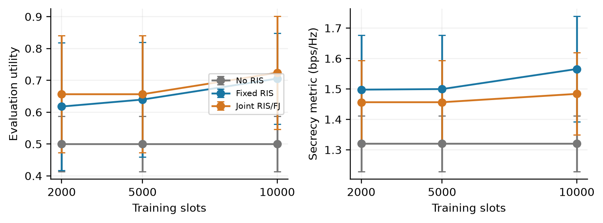
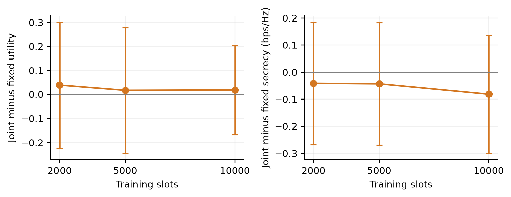
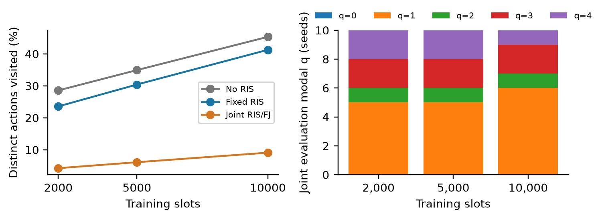
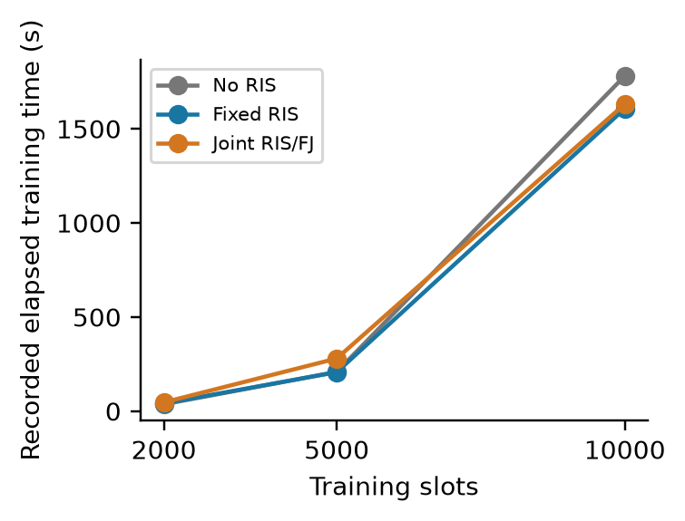
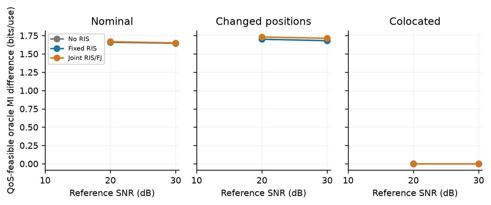

# Fixed and Joint Optical RIS–Friendly Jamming Control for Secure Visible Light Communication: A Matched Training-Budget Study

Authors: Mahidul Ahasan; Atikur Rahman; Md Amit Hasan Robi; Md Samiur Rahman Tanim.

Project Guide: Dr. Rima Deka, Assistant Professor, Department of Electronics, Assam down town University.

Generated reading companion to `main.tex`; edit that source and rerun `scripts/build_manuscript_sources.py` to keep the two versions synchronized. Author details remain provisional.

## Abstract

An optical reconfigurable intelligent surface (RIS) directs reflected light in visible light communication (VLC), but joint RIS and friendly-jamming (FJ) control substantially expands the reinforcement-learning action space. We evaluate this trade-off by extending an established DRL-FJ simulator with a six-facet specular RIS. We compare no RIS, fixed alignment toward the legitimate receiver (Bob), and joint control over 625 jammer weight vectors and five discrete mirror configurations. The empirical study analyzes 90 matched training runs across three schemes, ten random seeds, and budgets of 2,000, 5,000, and 10,000 slots, followed by 1,000-slot frozen policy evaluations. At 10,000 slots, joint-minus-fixed utility is $+0.0183$ (95% CI $[-0.1677, 0.2043]$, $p=0.8289$), and mean secrecy metrics are 1.5656 bps/Hz for fixed RIS and 1.4839 bps/Hz for joint control; their paired contrast is statistically inconclusive ($p=0.4182$). Full-family 18-contrast Holm adjustments show that secondary comparisons are sensitive to multiplicity (fixed secrecy Holm-$t$ $p=0.0696$; joint utility Holm-$t$ $p=0.3166$; fixed utility Holm sign-flip $p=0.0703$). Supplemental evaluations across five geometries show that zero-shot transfer of nominal-trained policies incurs utility gaps of 0.76 to 1.83 in the four changed geometries relative to same-geometry oracles without retraining. A consistent current-domain 4-PAM diagnostic confirms that positive secrecy (1.65–1.73 bits/channel use) is QoS-feasible at 20–30 dB reference SNR, whereas colocated eavesdropping yields identically zero secrecy. The nominal comparison detects no statistically significant advantage from joint discrete control within the tested budgets and delineates the limits of nominal-geometry policies.

Keywords: 
Visible light communication, optical RIS, friendly jamming, deep reinforcement learning, empirical comparison.

## Introduction

Visible light communication (VLC) carries data through modulated light from lighting fixtures. A receiver within the illuminated area may also observe that signal, so a useful indoor link does not by itself establish confidentiality [pathak2015visible, liu2024smart]. Friendly jamming introduces controlled interference from additional fixtures to reduce the usefulness of Eve's observation while limiting the cost to Bob, the intended receiver. Physical-layer security addresses this channel-level problem; it does not replace authentication or encryption [bloch2008wireless].

An optical reconfigurable intelligent surface (RIS) adds another control variable: the direction of reflected light. A mirror array changes facet orientations rather than radio-frequency phase shifts. A facet aimed from Alice toward Bob may increase Bob's channel gain, but can also reflect other fixtures. All sources must therefore be evaluated using the same installed facet normals, rather than separate ideal reflections for each source–receiver pair.

Additional control is not automatically useful to a finite-budget learner. Here, four jammer weights produce 625 actions. Adding five RIS configurations increases this to 3,125. The joint set contains the fixed-alignment actions, so its best available utility cannot be lower. A learned policy, however, may fail to find those actions. We ask whether joint control improves evaluated performance over fixed alignment when feature-network dimensions and training budgets are matched.

We address this question in a stationary room using a CNN and differentiable neural dictionary (DND) controller adapted from the DRL-friendly-jamming framework of Liu et al. [liu2024smart]. The contribution is a documented comparison within that implementation: a finite-aperture optical reflection model, enumeration of available discrete actions, and 90 matched training/evaluation runs. We do not claim that combining optical RIS and DRL is new, or that this implementation reproduces the 2024 paper's published curves. The results concern a specified simulator and geometry.

## Related Work and Scope

Liu et al. [liu2024smart] study secure VLC with multiple friendly jammers and use convolutional features with a DND to learn jamming decisions. Neural episodic control provides an earlier example of an action-indexed dictionary of feature keys and values [pritzel2017neural]. We retain the implemented friendly-jamming rate and BER expressions when adding reflected channels, rather than substituting a Gaussian-capacity model.

Optical reflecting surfaces have already been studied for VLC security. Qian et al. [qian2021secure] optimize reflected-spot positions using particle swarm optimization and compare the result with a fixed focus-on-Bob alignment and no IRS. Thus fixed-versus-adaptive reflection is itself an established comparison. Saifaldeen et al. [saifaldeen2022drl] jointly control fixture weights and mirror orientations using continuous-action DDPG with known user positions; their experiments include mobile users and approximately 100,000 training iterations. Our static discrete-action results at 2,000–10,000 slots cannot refute those continuous-control or mobility findings. Liu et al. [liu2026oris] subsequently report model-driven optical-RIS control for a secrecy, BER and energy utility. The latter description is supported by its primary abstract; the full text was not available for this review.

Our narrower comparison separates the best action available in a finite codebook from the performance obtained by one implemented learner. We do not reproduce those prior RIS controllers or claim better performance than them. Their models and decision spaces differ. Benchmarking against current alternatives and a broader literature assessment would be needed for a state-of-the-art claim.

## System and Threat Model

Figure 1 shows the simulated room and representative optical paths. The controller workflow is shown in Fig. 2.

### Room and assumptions

The room measures $5\times5\times3$ m. Alice is at $(2.5,2.5,3)$ m, Bob at $(1.8,1.6,0.85)$ m, and Eve at $(3.2,3.4,0.85)$ m. Four jammers occupy $(1.5,1.5,3)$, $(1.5,3.5,3)$, $(3.5,1.5,3)$, and $(3.5,3.5,3)$ m. Each fixture represents four downward-facing LEDs; both receivers face upward. The RIS is centered at $(2.5,0.25,2.6)$ m with nominal normal $+y$.

Eve is a passive receiver with a known position supplied to the simulator. Her presence does not block a path, change the room, or transmit interference. This study does not test protection against a moving person, an active attacker, or unknown Eve positions. The controller receives a four-value observation, but codebook construction uses exact scenario geometry, including Eve's position.

### Direct and effective gains

Let $G_{sr}$ denote optical path gain from fixture $s$ to receiver $r$. For a front-facing path inside the receiver field of view,

$$

G_{sr}^{\rm dir}=N_L\frac{(m+1)A_P}{2\pi d_{sr}^2}
\cos^m\phi_{sr}\cos\psi_{sr}\,g_c,

$$

and it is zero otherwise. Each fixture uses $N_L=4$ LEDs. The Lambertian order is $m=-\ln2/\ln(\cos\Phi_{1/2})$, with $\Phi_{1/2}=60^\circ$. Detector area is $A_P=10^{-4}$ m$^2$. The concentrator factor is $g_c=n_0^2/\sin^2\Psi_c$, with $n_0=1.5$ and $\Psi_c=60^\circ$. Filter transmission is unity. Electrical gain is

$$

h_{sr}=R_{\rm PD}\eta G_{sr},\quad
R_{\rm PD}=0.54\ {\rm A/W},\quad\eta=1\ {\rm W/A}.

$$

Responsivity and conversion efficiency are applied once. A corresponding current-domain signal notation is $y_r=h_{Ar}x_A+(\mathbf h_{Jr}^{T}\mathbf w)z+n_r$, with transmitter drive signals $x_A,z$. The electrical gain is not multiplied by responsivity again. This notation identifies the gains; the experimental rate and BER metrics are specified separately below.

For configuration $q$, effective gains are

$$

h_{sr}(q)=h_{sr}^{\rm dir}
+R_{\rm PD}\eta\sum_{k=1}^{6}G_{srk}^{\rm RIS}(q).

$$

This scalar DC model adds received optical power contributions before electrical conversion. It does not model coherent optical phase cancellation, delay spread, or intersymbol interference.

### Inherited secrecy and BER metrics

The following equations specify the simulator used for the runs, following its literal paper-mode implementation of the 2024 baseline expressions [liu2024smart]. Let $b=\mathbf h_{JB}^{T}\mathbf w$, $e_J=|\mathbf h_{JE}^{T}\mathbf w|$, and $a=\alpha I_D$, with $\alpha=0.1$ and $I_D=P_T/\eta=1$ A. The gain calculation sums four identical LEDs per fixture receiving the same drive, so $P_T$ is the per-LED optical bias parameter in this convention. The Bob term is

$$

B=\frac12\log_2\!\left(1+
\frac{2h_{AB}(q)^2a^2}{\pi\mathrm e(\sigma_B^2+2b^2a^2)}\right).

$$

For $h_{AE}>0$ and $e_J>0$, define $\ell=\log_2\sqrt{\mathrm e}$ and

$$

L_E=\min\!\left\{\log_2\frac{h_{AE}}{e_J}
+\frac{e_J}{h_{AE}}\ell,\quad\frac{h_{AE}}{e_J}\ell\right\}.

$$

The secrecy metric is $R_s=\max(0,B-L_E)$, reported in bps/Hz using the baseline convention. When $h_{AE}=0$, the implementation returns $B$; when $h_{AE}>0$ and $e_J=0$, it returns zero. This no-jamming boundary convention is inherited from the implementation, not a general wiretap-channel result.

The implemented Bob error metric is

$$

p_B=\frac34\operatorname{erfc}\!\left(
\sqrt{\frac{2P_T(h_{AB}+b)^2}{5\sigma_B^2}}\right),\quad P_T=1.

$$

Its signed jammer term is added inside an amplitude square. This must not be interpreted as a separately validated BER for arbitrary independent optical interference. Equations (4)–(6) are retained for a consistent simulator comparison, not derived here as a new unified physical channel model.

The noise parameter is the numeric baseline conversion $10^{(-98.79-30)/10}=1.3213\times10^{-13}$. Paper mode uses this watt-valued number directly as $\sigma_B^2$, without a specified impedance conversion to current variance. This normalization remains unresolved. A separate current-domain diagnostic mode exists in the code but was not used in these RIS runs. The reported metrics are therefore not calibrated hardware predictions or an exact reproduction of the baseline paper's numerical figures.

### Actions and utility

Each jammer weight belongs to $\{-1,-0.5,0,0.5,1\}$, giving $5^4=625$ vectors. Negative weights represent signed modulation about a positive drive bias, not negative optical power. Utility is

$$

U=R_s-3.5p_B-0.4E,\qquad E=\sum_{i=1}^{4}|w_i|.

$$

$E$ is a nonnegative amplitude cost, not energy in joules. This explicit L1 interpretation avoids rewarding negative signed sums. The study preserves the baseline rate/BER implementation while documenting its cost interpretation; it does not claim that every baseline convention is uniquely specified by the paper. RIS switching energy and settling time are excluded. The reward imposes no hard Bob-service constraint.

## Finite-Aperture Optical RIS

### Geometry and reflection calculation

Six square facets occupy a $2\times3$ grid within a $1\times0.5$ m panel envelope. The pitches are $1/3$ and $0.25$ m. Facet side is $0.9\min(1/3,0.25)/\sqrt2=0.15910$ m, allowing rotation clearance; total reflecting area is $0.151875$ m$^2$, rather than the full envelope area. Reflectivity is $\rho=0.85$. Tilt from $+y$ is limited to $85^\circ$.

For source $\mathbf S$, facet center $\mathbf M_k$, and unit normal $\mathbf n_k$, the image source is

$$

\mathbf S'_k=\mathbf S-2[(\mathbf S-\mathbf M_k)\cdot\mathbf n_k]\mathbf n_k.

$$

The LED axis is reflected by the same operation. Both source and receiver must lie in front of the facet. Rays from $\mathbf S'_k$ through its corners form a polygon on the receiver's horizontal plane. Backward, parallel, or degenerate projections contribute zero. The polygon is clipped against a square effective entrance aperture of area $A_Pg_c$ centered on the receiver. This aperture is a geometric approximation, not a wave-optical lens model.

Let $\mathcal C_{srk}$ be that clipped polygon and $\mathcal T_k$ the mirror square. Define

$$

J_{srk}=\int_{\mathcal C_{srk}}\frac{m+1}{2\pi L^2}
\cos^m\phi'\cos\psi'\,\mathbf1_{\rm FOV}\,dA,

$$

where $L$ is the image-source distance to the integration point. Non-emitting or back-facing directions contribute zero. The power fraction intercepted from one LED is

$$

F_{sk}=\int_{\mathcal T_k}\frac{m+1}{2\pi d^2}
\cos^m\phi\,[\cos\theta]_+\,dA,

$$

again excluding non-emitting directions. The implemented gain is

$$

G_{srk}^{\rm RIS}=\rho N_L\min(J_{srk},F_{sk}).

$$

Clipped polygons are triangulated and evaluated with a symmetric three-point triangle rule. The intercepted fraction uses a $3\times3$ Gauss–Legendre rule. The cap bounds each receiver path by the facet's reflected intercepted power; it does not establish a global power-allocation proof for arbitrary collections of receivers. These equations specify the numerical geometric-optics model used in the experiment.

### Five configurations

The inactive reference $q=0$ gives exactly zero reflected gain by definition. At $q=1$, all facets aim Alice toward Bob. At $q=2$, facets are assigned round-robin to the four jammers and aimed toward Eve. At $q=3$, the first three aim Alice toward Bob and the remaining three use jammer-to-Eve targets. At $q=4$, all normals remain along $+y$. An ideal target normal bisects the source and receiver unit directions from the facet center, subject to the tilt limit.

Every source–receiver path is evaluated with the same six installed normals. A facet targeted at one source may still reflect another if geometry permits. There is no independent per-link orientation. The codebook is constructed for the supplied positions and remains fixed during each run.

## Learning and Experimental Protocol

### Matched controller

No RIS fixes $q=0$; fixed RIS fixes $q=1$. Both learn among 625 jammer vectors. Joint RIS/FJ selects from their Cartesian product with five configurations. Matching the CNN does not match action-indexed DND size or occupancy; that difference is part of the comparison.

The pre-action observation is

$$

\mathbf s_t=[p_{B,t-1},R_{s,t-1},h_{AB}(q_{t-1}),E_{t-1}]^T.

$$

It includes the installed channel, not the gain of a subsequently selected configuration. Eleven prior state–action pairs and the current state form the history. Baseline and fixed histories contain 92 values; joint histories add the normalized codebook coordinate $q/2-1$ and contain 103. Both are zero-padded to an $11\times11$ input.

The CNN uses 20 filters of size $3\times3$, then 40 of size $2\times2$, both with unit stride, followed by dense layers $2560\to180\to180$. All schemes have 497,000 CNN parameters. An action-specific DND uses normalized Gaussian weights $\exp(-\|\mathbf k-\mathbf k_j\|^2/2)$; an empty dictionary returns zero. The DND update uses Q-learning step size 0.5 and discount factor 0.5. SGD updates the CNN using learning rate 0.01, a replay minibatch of four, and squared temporal-difference residuals.

The first eleven actions initialize history randomly. Later decisions are epsilon-greedy, starting at 0.15, decaying by 0.998 per slot, with floor 0.02. A shared seed initializes matched schemes, but their different action sets produce different stochastic paths. Matching seeds is a blocking convention, not identical exploratory decisions.

### Runs and statistical unit

We analyze 90 completed protocol-v2 records: three schemes, seeds 42–51, and budgets of 2,000, 5,000, and 10,000 slots. Each budget starts a fresh training run, not continuation from a shorter checkpoint. Geometry, L1 cost, CNN dimensions, and noise parameter are shared. Legacy records with unmatched CNN dimensions are excluded.

Evaluation resets the environment and history, then uses 1,000 greedy slots with an evaluation-mode CNN and frozen DND. No evaluation experience updates the policy. Each run supplies one evaluation mean, giving ten seed-level replicates. The 1,000 slots are not independent room realizations and are not treated as the statistical sample size.

Means are reported with seed-level standard errors and two-sided Student-$t$ intervals. Contrasts use ten within-seed differences and nine degrees of freedom. The study manifest identifies joint-minus-fixed utility at 10,000 slots as primary; this is not a claim of prospective public preregistration. Other comparisons are exploratory. We retain their unadjusted values for transparency and add a post-hoc Holm sensitivity correction across all 18 reported contrasts: three budgets, three scheme comparisons and two metrics. We also enumerate all 1,024 sign patterns of each ten-seed difference vector. That sign-flip analysis assumes symmetry under the null; it is not a randomized-treatment causal test. All intervals are pointwise. These analyses describe seed variation in this protocol, not performance across a population of rooms.

Frozen evaluation means $\pm$ seed-level standard error ($n=10$). Coverage is mean distinct training actions divided by each scheme's action count. Recorded elapsed training time excludes evaluation.

| Slots | Scheme | Utility | Secrecy metric (bps/Hz) | Coverage (%) | Time (s) |
| — | — | — | — | — | — |
| 2,000 | No RIS | $0.5005 \pm 0.0383$ | $1.3205 \pm 0.0405$ | 28.59 | 37.2 |
| 2,000 | Fixed RIS | $0.6178 \pm 0.0888$ | $1.4978 \pm 0.0793$ | 23.58 | 41.3 |
| 2,000 | Joint RIS/FJ | $0.6565 \pm 0.0813$ | $1.4565 \pm 0.0604$ | 4.26 | 47.4 |
| 5,000 | No RIS | $0.5005 \pm 0.0383$ | $1.3205 \pm 0.0405$ | 34.94 | 209.2 |
| 5,000 | Fixed RIS | $0.6396 \pm 0.0797$ | $1.4996 \pm 0.0786$ | 30.43 | 207.8 |
| 5,000 | Joint RIS/FJ | $0.6565 \pm 0.0813$ | $1.4565 \pm 0.0604$ | 6.12 | 280.4 |
| 10,000 | No RIS | $0.5005 \pm 0.0383$ | $1.3205 \pm 0.0405$ | 45.36 | 1781.7 |
| 10,000 | Fixed RIS | $0.7056 \pm 0.0632$ | $1.5656 \pm 0.0766$ | 41.30 | 1608.2 |
| 10,000 | Joint RIS/FJ | $0.7239 \pm 0.0784$ | $1.4839 \pm 0.0598$ | 9.11 | 1632.2 |

## Results

### Joint versus fixed RIS

At 10,000 slots, utility means are 0.7056 for fixed RIS and 0.7239 for joint RIS/FJ (Table 1). The paired difference is $+0.0183$, with 95% CI $[-0.1677,0.2043]$ and $p=0.8289$. The interval includes differences favoring either scheme. It establishes neither equivalence nor the absence of a benefit at larger budgets or in other geometries.

The mean secrecy metric is 1.5656 bps/Hz for fixed RIS and 1.4839 bps/Hz for joint control. Their paired difference is $-0.0817$ bps/Hz (95% CI $[-0.2996,0.1362]$, $p=0.4182$). The numerical ordering favors fixed RIS, but the uncertainty does not support a superiority claim. Utility and secrecy orderings differ because of the cost term: mean amplitude costs are 2.15 and 1.90 for fixed and joint control, respectively.

Paired contrasts at 10,000 slots ($n=10$, $df=9$). All $p$-values are two-sided and unadjusted. Only joint-minus-fixed utility is primary.

| Contrast | Metric | Mean difference | 95% confidence interval | $p$ |
| — | — | — | — | — |
| Joint RIS/FJ $-$ Fixed RIS | $U$ | $+0.0183$ | $[-0.1677, +0.2043]$ | 0.82887 |
| Joint RIS/FJ $-$ Fixed RIS | $R_s$ | $-0.0817$ | $[-0.2996, +0.1362]$ | 0.41825 |
| Fixed RIS $-$ No RIS | $U$ | $+0.2051$ | $[+0.1220, +0.2881]$ | 0.00034 |
| Fixed RIS $-$ No RIS | $R_s$ | $+0.2451$ | $[+0.0999, +0.3902]$ | 0.00409 |
| Joint RIS/FJ $-$ No RIS | $U$ | $+0.2234$ | $[+0.0394, +0.4074]$ | 0.02261 |
| Joint RIS/FJ $-$ No RIS | $R_s$ | $+0.1634$ | $[-0.0226, +0.3494]$ | 0.07818 |

### Comparison with no RIS

At 10,000 slots, fixed RIS improves utility over no RIS by $+0.2051$ (95% CI $[0.1220,0.2881]$, unadjusted $p=0.00034$). Its secrecy improvement is $+0.2451$ bps/Hz (95% CI $[0.0999,0.3902]$, $p=0.00409$). These are improvements within the specified metric model and geometry.

Joint control improves utility over no RIS by $+0.2234$ (95% CI $[0.0394,0.4074]$, $p=0.02261$). Its secrecy difference is $+0.1634$ bps/Hz, but the interval includes zero ($[-0.0226,0.3494]$, $p=0.07818$). The fixed-RIS statistic must not be used as evidence that both schemes improve both metrics. Baseline and joint means also remain unchanged between 2,000 and 5,000 slots; more training did not improve every policy.

### Multiplicity and distributional sensitivity

The fixed-minus-no-RIS utility contrast has Holm-adjusted $t$-test $p=0.00614$ across the full 18-comparison family. The corresponding secrecy contrast has adjusted $p=0.06956$. For joint minus no RIS, the adjusted values are 0.31661 for utility and 1.00000 for secrecy. The fixed utility contrast also has an unadjusted sign-flip $p=0.00391$, which becomes 0.07031 after the same full-family correction. Consequently, the apparent strength of secondary findings depends on the testing assumptions and multiplicity treatment. Higher observed means should not be described as universal or confirmatory security gains.

Post-hoc statistical sensitivity at 10,000 training slots. Holm corrections cover all 18 contrasts across three budgets, not only these six rows. Sign-flip values enumerate 1,024 patterns and require a symmetric null distribution.

| Contrast | Metric | $t$-test $p$ | Holm $p$ | Sign-flip $p$ | Holm sign-flip $p$ |
| — | — | — | — | — | — |
| Joint $-$ Fixed | $U$ | 0.82887 | 1.00000 | 0.83594 | 1.00000 |
| Joint $-$ Fixed | $R_s$ | 0.41825 | 1.00000 | 0.41992 | 1.00000 |
| Fixed $-$ None | $U$ | 0.00034 | 0.00614 | 0.00391 | 0.07031 |
| Fixed $-$ None | $R_s$ | 0.00409 | 0.06956 | 0.00781 | 0.13281 |
| Joint $-$ None | $U$ | 0.02261 | 0.31661 | 0.02539 | 0.38086 |
| Joint $-$ None | $R_s$ | 0.07818 | 1.00000 | 0.08789 | 0.99023 |

### Finite-grid ceiling and exploration

Enumeration evaluates all 3,125 joint actions using the same channel and utility functions. Maximum utility is 0.995914 at $q=1$. Maximum secrecy is 1.841295 bps/Hz, also at $q=1$, though not necessarily for the same jammer vector. Fixed RIS therefore contains an action attaining each joint finite-grid maximum. This is not an upper bound over continuous orientations or other geometries.

Mean distinct joint actions visited increase from 133.0 to 191.4 and 284.8 across the three budgets: 4.26%, 6.12%, and 9.11% of 3,125 actions. At 10,000 slots, no RIS and fixed RIS cover 45.36% and 41.30% of their smaller sets. Low fractional coverage is consistent with an exploration burden, but exhaustive coverage is not required for a good policy. Coverage alone does not identify the cause of the measured performance.

At 10,000 slots, six joint runs have modal evaluation configuration $q=1$; four use $q=2$, 3, or 4. This describes the measured horizon, not permanent trapping or proof that each other configuration is always inferior. A targeted exploration ablation would be needed to attribute the outcome specifically to action-set expansion.

### Recorded computational cost

Mean elapsed training times at 10,000 slots are 1,781.7 s for no RIS, 1,608.2 s for fixed RIS, and 1,632.2 s for joint control. These are original execution measurements, not controlled hardware benchmarks. Worker-pool execution shares machine resources; memory occupancy and host load can affect time. The records do not support a blanket computational-superiority claim. Mechanical actuation time is not included.

## Supplementary Geometry and Channel Checks

### Finite-grid sensitivity and frozen-policy transfer

The supplemental protocol fixes five geometries before evaluating their outcomes: nominal; Bob $(2,3,0.85)$ and Eve $(3.5,1.5,0.85)$; swapped nominal Bob/Eve coordinates; Eve moved to $(1.9,1.7,0.85)$ near nominal Bob; and receivers colocated at nominal Bob. We enumerate 3,125 actions in each geometry at noise offsets of $-3$, 0 and $+3$ dB relative to the historical numeric noise parameter. These 15 cases are sensitivity analyses of the implemented metric, not a physical calibration of that parameter.

Finite-grid oracle utility at the historical noise parameter. The joint maximum is over all five configurations; the last column is one maximizing configuration. These are attainable discrete optima, not learned-policy results.

| Geometry | No RIS | Fixed RIS | Joint oracle | Joint $q^*$ |
| — | — | — | — | — |
| Nominal | 0.7119 | 0.9959 | 0.9959 | 1 |
| Changed positions | 0.9550 | 1.0418 | 1.0418 | 1 |
| Swapped receivers | 0.7119 | 0.7409 | 0.7719 | 2 |
| Nearby Eve | 0.0000 | 0.0000 | 0.0000 | 0 |
| Colocated | 0.0000 | 0.0000 | 0.0000 | 0 |

We also evaluate the 30 nominal-trained 10,000-slot policies in the four changed geometries, using 200 frozen slots per policy and geometry. The resulting 120 cases are zero-shot policy transfers. The mirror codebook is reconstructed from exact new positions before evaluation, so this is not unknown-CSI testing, learned tracking or a moving-user experiment. Nominal results in Fig. 7 use the original 1,000-slot evaluation; changed geometries use the separate 200-slot transfer protocol. Means and standard errors use ten seeds, and each policy is compared with the oracle of its own action set in the same geometry.

Figure 7 and Table 4 quantify the sensitivity of the learned and oracle policies to geometric displacement. In the nominal geometry, the finite-grid oracle achieves utility 0.7119 (no RIS) and 0.9959 (both fixed and joint RIS), leaving modest gaps of 0.2113, 0.2903, and 0.2720 for the respective learned policies. When user positions are altered without policy retraining, performance degrades sharply. In the changed-positions geometry, all three nominal-trained policies yield negative mean utilities ($-0.6451$ baseline, $-0.7876$ fixed RIS, and $-0.5608$ joint control), producing optimality gaps exceeding 1.6 against oracles that attain positive utility ($0.9550$–$1.0418$). When receiver locations are swapped, all frozen policies suffer complete secrecy collapse ($R_s=0.0$, utility $\le -0.76$), whereas the geometry-aware oracle maintains positive utility ($0.7119$–$0.7719$) by selecting configuration $q=2$ to direct reflections toward Eve. In the nearby-Eve and colocated geometries, both the frozen policies and the discrete oracles yield zero secrecy. Oracle utility is zero, while the frozen policies retain mean utilities of $-0.82$ (no RIS), $-0.86$ (fixed RIS), and $-0.76$ (joint control) because they continue to incur jamming costs. The colocated case functions as an empirical negative control, verifying that no controller can manufacture physical-layer secrecy when spatial channel differentiation is absent. These outcomes confirm that nominal DRL policies fail to generalize zero-shot to altered room geometries, even when mirror codebooks are updated with exact coordinates.

### A consistent current-domain diagnostic

The historical reward is retained for the learner comparison, but its literal BER convention is not a general independent-jamming model. With a symmetric jammer independent of the information signal, reversing all weights leaves the disturbance distribution unchanged. Equation (6), containing $(h_{AB}+\mathbf h_{JB}^{T}\mathbf w)^2$, does not generally preserve that symmetry. Selecting a different positive noise scaling cannot repair this structural difference.

We therefore evaluate a separate channel with equiprobable Gray-labelled 4-PAM symbols $X\in A\{-1,-1/3,1/3,1\}$, a shared jammer $J\sim\mathcal U[-A,A]$ independent of $X$, and independent Gaussian receiver-current noise. Here $A=\alpha I_D$. Fixture $i$ transmits $w_iJ$ about its DC bias. With $b_r=A|\mathbf h_{Jr}^{T}\mathbf w|$, the conditional density for $b_r>0$ is

$$

p_r(y\mid x)=\frac{1}{2b_r\sigma_r}\int_{-b_r}^{b_r}
\varphi\!\left(\frac{y-h_{Ar}x-u}{\sigma_r}\right)du,

$$

where $\varphi$ is the standard normal density. At $b_r=0$, it reduces to the Gaussian density with mean $h_{Ar}x$ and variance $\sigma_r^2$. Both receivers use this same channel law. Eve is assumed not to know the instantaneous jammer realization.

The information statistic uses the stated input distribution:

$$

\begin{aligned}
I_r&=\frac14\sum_{m=0}^{3}\int p_r(y\mid x_m)
\log_2\frac{p_r(y\mid x_m)}{p_r(y)}\,dy,\\
p_r(y)&=\frac14\sum_{m=0}^{3}p_r(y\mid x_m),\qquad
R_{\mathrm{diag}}=[I_B-I_E]_+ .
\end{aligned}

$$

$R_{\mathrm{diag}}$ is measured in bits per real channel use and is bounded by two. It is not a general secrecy-capacity computation or a bps/Hz conversion. For Bob's midpoint decisions, with ordered thresholds $(-\infty,-2h_{AB}A/3,0,2h_{AB}A/3,\infty)$ and Gray labels $\boldsymbol{\beta}_m$, the uncoded BER is

$$

P_{b,B}=\frac18\sum_{m,n=0}^{3}
d_H(\boldsymbol{\beta}_m,\boldsymbol{\beta}_n)
\int_{\tau_n}^{\tau_{n+1}}p_B(y\mid x_m)\,dy.

$$

This is the BER of a specified midpoint receiver, not a claim that it is optimal for every interference distribution. Mutual information is evaluated before those hard decisions.

Noise is declared in A$^2$, using nominal direct-Bob symbol variance $V_{\mathrm{ref}}=(5/9)(h_{AB,\mathrm{ref}}^{\mathrm{dir}}A)^2$. At reference SNR $s=10$, 20 or 30 dB, both receivers have $\sigma_r^2=V_{\mathrm{ref}}10^{-s/10}$. The current variance is fixed across schemes and geometries at each SNR, rather than renormalized after RIS gain or Bob movement. This convention does not infer the baseline authors' unspecified impedance or SNR normalization.

The diagnostic enumerates the nominal, changed-position and colocated geometries, yielding nine scenario/SNR grids. Table 5 reports the largest information difference subject to modeled Bob BER at most $10^{-3}$; infeasibility is shown explicitly. These are finite-grid oracle results under the declared physical alternative, not DRL training results or a replacement of historical rewards.

Current-domain finite-grid maximum $R_{\mathrm{diag}}$ in bits/use subject to $P_{b,B}\leq10^{-3}$. A dash denotes no feasible action. SNR uses the same nominal-direct reference across all geometries and schemes.

| Geometry | Reference SNR (dB) | No RIS | Fixed $q=1$ | Joint oracle |
| — | — | — | — | — |
| Nominal | 10 | – | – | – |
| Nominal | 20 | 1.6586 | 1.6638 | 1.6673 |
| Nominal | 30 | 1.6463 | 1.6463 | 1.6504 |
| Changed | 10 | – | – | – |
| Changed | 20 | 1.7009 | 1.7009 | 1.7315 |
| Changed | 30 | 1.6809 | 1.6809 | 1.7135 |
| Colocated | 10 | – | – | – |
| Colocated | 20 | 0.0000 | 0.0000 | 0.0000 |
| Colocated | 30 | 0.0000 | 0.0000 | 0.0000 |

As shown in Table 5 and Fig. 8, QoS feasibility and secrecy under the consistent 4-PAM model depend heavily on receiver SNR. At 10 dB reference SNR, no discrete action meets the Bob BER threshold of $10^{-3}$ across any geometry; the QoS-constrained secrecy difference is therefore empty. At 20 dB and 30 dB SNR, feasible actions emerge. In the nominal geometry at 20 dB, the maximum QoS-feasible information difference is 1.6586 bits/use without RIS, 1.6638 bits/use under fixed RIS ($q=1$), and 1.6673 bits/use under the joint oracle. In the changed-positions scenario, the joint oracle achieves 1.7315 bits/use at 20 dB compared to 1.7009 bits/use for both no-RIS and fixed-RIS baselines. At 30 dB, the joint optima decrease to 1.6504 bits/use nominally and 1.7135 bits/use in changed positions. Within each geometry, the maximizing jammer weights and their L1 amplitude cost are unchanged from 20 dB. In the colocated setting, the information difference is identically 0.0000 bits/use at all SNR levels, matching theoretical expectation. Crucially, these values represent discrete exhaustive optima under the alternative 4-PAM physical model, not trained DRL performance or evidence of reinforcement learning convergence.

## Limitations and Reproducibility

Learning is performed in one stationary nominal geometry with one oracle codebook and one learner. The added sensitivity and zero-shot evaluations broaden the test conditions, but they do not supply independently trained learners in those geometries or validate continuous mobility. Fixed $q=1$ benefits from known geometry and happens to contain the nominal best finite-grid actions. Earlier scenario-specific project runs are not pooled here because their protocols and budgets differ. Continuous-action prior controllers were not reimplemented, so no state-of-the-art comparison is claimed.

Neither a soft reward nor a positive secrecy metric guarantees uninterrupted service or prevents all decoding by Eve. The study does not transmit packets or test coding, hardware, movement, blockage, or cryptographic security. Near-zero modeled BER can follow from the inherited expression and scaling; it does not demonstrate measured error-free reception. The unresolved noise normalization and literal BER convention limit physical interpretation. The 2024 paper's published numerical curves have not been reproduced exactly.

The evidence includes 90 raw run records, a protocol manifest and saved CNN/DND artifacts. Antigravity executed the 98-test implementation suite and a fresh reload of all 90 saved policies. Every policy was evaluated for 1,000 slots, comparing 360,000 stored metric values across utility, secrecy, BER and amplitude cost at absolute tolerance $10^{-10}$. The replay also checks first actions and full RIS-configuration counts. These are implementation and inference-replay checks, not a proof of hardware validity. Training records preserve summaries and coverage counts rather than a complete exported slot trajectory. Run Git identifiers do not uniquely identify uncommitted code used during execution. Current file hashes support later auditing but do not retroactively prove the original training working-tree state.

## Conclusion

Adding an optical RIS changes the friendly-jamming simulator's channels and available decisions. In 90 architecture-matched runs, joint control has a slightly higher utility mean than fixed RIS, but the paired interval includes zero; their secrecy comparison is also inconclusive. Fixed RIS has higher observed nominal utility and secrecy than no RIS, although the strength of secondary evidence depends on distributional assumptions and multiplicity correction. Enumeration separates the best available action from the policy found by learning. The current-domain diagnostic also separates physically consistent information/error calculations from inherited reward conventions. These distinctions are necessary before attributing a benefit to joint control. Continuous mobility, uncertain channel information and retraining under the consistent finite-alphabet model remain outside this study.

## Data, Code and AI Assistance

The accompanying reproducibility package contains run records, analysis code, supplementary grid data, test logs and source manifests. Full saved-policy payloads are kept separately from the compact manuscript package and identified by hashes. A final public archival location must be assigned when the authors deposit the release. Codex and Antigravity assisted code development, computational orchestration and manuscript drafting/revision. Execution logs identify the computational checks; final methodological and authorship review remains the responsibility of the authors.

## Project Guide

Dr. Rima Deka, Assistant Professor, Department of Electronics, Assam down town University, supervised this project.

## References

- [liu2024smart] Liu, Sicong; Liu, Xianbin; Du, Xiaojiang; Guizani, Mohsen. Smart Jamming for Secrecy: Deep Reinforcement Learning Enabled Secure Visible Light Communication. IEEE Transactions on Wireless Communications, 2024. https://doi.org/10.1109/TWC.2024.3458046
- [pathak2015visible] Pathak, Parth H.; Feng, Xiaotao; Hu, Pengfei; Mohapatra, Prasant. Visible Light Communication, Networking, and Sensing: A Survey, Potential and Challenges. IEEE Communications Surveys &amp; Tutorials, 2015. https://doi.org/10.1109/COMST.2015.2476474
- [bloch2008wireless] Bloch, Matthieu; Barros, JoÃo; Rodrigues, Miguel R. D.; McLaughlin, Steven W.. Wireless Information-Theoretic Security. IEEE Transactions on Information Theory, 2008. https://doi.org/10.1109/TIT.2008.921908
- [qian2021secure] Qian, Lei; Chi, Xuefen; Zhao, Linlin; Chaaban, Anas. Secure Visible Light Communications via Intelligent Reflecting Surfaces. ICC 2021 - IEEE International Conference on Communications, 2021. https://doi.org/10.1109/ICC42927.2021.9500409
- [saifaldeen2022drl] Saifaldeen, Danya A.; Ciftler, Bekir S.; Abdallah, Mohamed M.; Qaraqe, Khalid A.. DRL-Based IRS-Assisted Secure Visible Light Communications. IEEE Photonics Journal, 2022. https://doi.org/10.1109/JPHOT.2022.3178852
- [liu2026oris] Liu, Sicong; Zhang, Hong; Song, Linqi; Han, Zhu. Optical Reflecting Intelligent Surface-Assisted Secure Visible Light Communication: An Inverse Pre-Reflection Model-Driven Deep Reinforcement Learning Approach. IEEE Transactions on Wireless Communications, 2026. https://doi.org/10.1109/TWC.2026.3708130
- [pritzel2017neural] A. Pritzel et al. Neural Episodic Control. PMLR 70:2827–2836, 2017. https://proceedings.mlr.press/v70/pritzel17a.html
